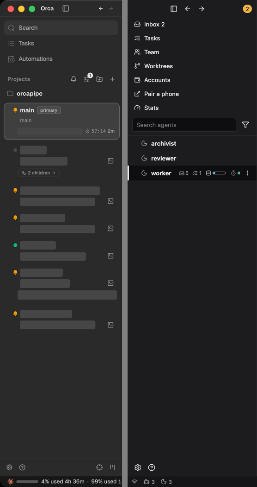
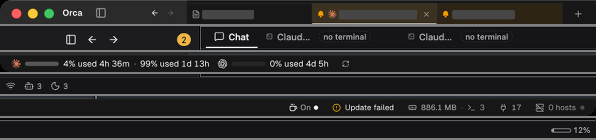
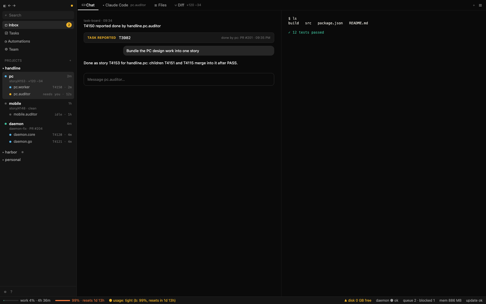

# PC app: how it compares with Orca, and a visual proposal

Story 10-4 (T4149, task T4150). Research and a proposal only; nothing is built. The question: can our PC app be as clean as Orca?

Method. Orca 1.4.221 (the installed app) and the PC app (`apps/web` in `apps/electron`, main @67f4d5063, scratch home and test daemon, never the live daemon) were captured at the same size, 1673 x 1050 points. The scratch daemon is nearly empty (three agents, one task), so the screens show structure, not a busy day. The Orca pictures show only its chrome (sidebar, tab strip, status bar), with its project, branch and tab names masked.

## 1. Side by side

Sidebar, Orca left, ours right:

Top tab strip and bottom status bar (each pair: Orca above, ours below; left and right halves of the status bar):

Our screens at the same size: [Inbox](img/pc-visual/01-home.png), [Tasks](img/pc-visual/02-tasks.png), [Task detail](img/pc-visual/03-task-detail.png), [Team](img/pc-visual/04-team.png), [Worktrees](img/pc-visual/05-worktrees.png), [Accounts](img/pc-visual/06-accounts.png), [Stats](img/pc-visual/07-stats.png), [agent Chat](img/pc-visual/08-chat.png).

## 2. Differences, ordered by how much each changes the feel

1. **One sidebar that is the whole map (layout).** Orca: Search, Tasks, Automations, then Projects; under each project its worktrees as cards (name, branch, status line, age) and the sessions under them, so you never leave it to find work. Ours: seven nav rows (190 px of the 1050) above a flat agent list; worktrees are a separate page and an agent row shows no project, branch or age.
2. **Workspaces instead of pages (layout).** Orca has one surface: the chosen worktree's tab strip (chat, files, terminals, diff) with split panes. Ours is a set of pages, each with a title and its own box; "an agent", "its worktree" and "its tasks" are three screens in ours, one in Orca.
3. **The bottom bar says something (layout, density).** Orca's carries usage per account, update state, memory, ports and hosts; ours has agent counts that repeat the sidebar and one unlabeled percentage (section 5).
4. **Density and quiet rows (density).** Orca rows carry one dot, a medium-weight name and one grey second line. Ours carry up to six marks per agent row (state glyph, inbox count, task count, two gauges, a menu) with a bold name. More symbols in less space reads as busy.
5. **Boxes inside boxes (borders).** Ours: the Tasks table and its detail each sit in a bordered panel, Team is a row of bordered cards, Inbox rows and the composer are bordered. Orca separates areas with one 1 px hairline and fills only the selected row (rule in section 4).
6. **Chrome merged with the title bar (layout).** Orca's tab strip is the window's top bar. Ours has a 38 px drag strip over the sidebar and a second strip for tabs: two bars where one would do.
7. **Colour (colour).** Both are near-black neutral. Orca uses one warm accent, amber, for "needs you" and few small status dots. Our Okabe-Ito state hues are fine but appear on many rows at once, and amber sits in two places (corner badge and pills). The change is fewer colours at a time, not a new palette.
8. **Type (type).** Orca: Geist, 13 px body, 12 px and 11 px for second lines, names at weight 500, monospace only for terminals and ids. Ours: Inter at the same sizes, names 500 in the token but several screens render them heavier, and monospace is used for times and owners in table rows. No size change is needed; weight and where mono is used.
9. **Icons (icons).** Both use thin outline icons; Orca labels each, ours has icon-only controls in chat and row headers that need a tooltip.
10. **Empty states (empty states).** Orca: the sidebar holds the next step (Add project, +). Ours: "Pick an agent / Choose one in the list", "No accounts configured.", "No agents in the team" with no action beside them (screens 08, 04 and 06).

## 3. Orca's licence: what we may take

Orca (stablyai/orca, homepage in its package.json) ships a `LICENSE` file in the app: MIT, "Copyright (c) 2026 Lovecast Inc." The same file is in the installed 1.4.221 bundle and in the repository's `LICENSE` on `main` (checked 2026-10-16); read it again at the commit we copy from.

MIT lets us copy, modify and ship, on the one condition that the copyright and permission notice stay with copies or substantial portions. So:

- **Take with the notice:** component code and CSS (sidebar and worktree card, tab strip, status-bar cells, split-pane layout). Put the notice in a `THIRD_PARTY_NOTICES` file shipped with the app and mark copied files with a header comment.
- **Take freely (ideas, not code):** the layout, the order of information, the row anatomy, the spacing scale and the colour values. Colour and size numbers are not copyrightable and Orca's neutrals are close to the stock shadcn/ui ones (also MIT).
- **Not covered by this licence:** the Orca name and logo, and the Geist font (SIL Open Font License from Vercel; it can be bundled, with its licence text). We should keep our own mark and Inter, or add Geist deliberately.
- **Recommendation:** write our own components to section 4 and copy code (with the notice) only where it saves real work, likely split panes.

## 4. Proposed style

We already have the token layer (`apps/web/src/tokens.css`), and the values below are changes to it, not a new system. Dark is the reference; light follows by the same rules.

**Colour.** Neutral greys, one accent, state hues only beside a dot.

| Token | Now | Proposed | Why |
| --- | --- | --- | --- |
| `--bg-0` canvas | #0e0e10 | #0a0a0a | Pure neutral, no blue tint (Orca #0a0a0a) |
| sidebar, status bar (new `--bg-side`) | `--bg-1` #151517 | #141414 | Sidebar and bars one step lighter than the canvas |
| `--bg-2` cards, inputs | #1c1c1f | #171717 | Used for the composer and popups only |
| `--bg-3` selected row, hover | #26262a | #262626 | Same step as Orca |
| `--line` hairline | #2b2b30 solid | #ffffff12 | One 1 px line at 7% white; follows any surface |
| `--line-strong` | #3d3d44 | #ffffff26 | Inputs and focus edges only |
| `--ink` / `--ink-2` / `--ink-3` | #ececee / #a3a3ab / #6f6f78 | #fafafa / #a1a1a1 / #6b6b6b | Orca's foreground and muted foreground |
| accent "needs you" | `--s-wait` #f0b429 | same | The only warm colour; badge, bell, pill |
| `--s-working` / `--s-ok` / `--s-bad` | as now | as now | Dots and gauges only, never text fills |

**Type.** One sans, one mono, four sizes: 13 body, 12 label, 11 hint, 15 title (page titles go away with section 2, item 2). Names 500, everything else 400; mono only for ids, branches, times in tables and terminals. Keep Inter; Geist is an option if Orca's look is preferred after seeing both.

**Spacing and size.** Spacing steps as now (`--sp-*`, 2 to 32 px). Sidebar 264 px (240 in tokens, 280 rendered). Tab strip 36 px (32 now), merged with the title bar. Status bar 26 px (24 now). Row heights: nav row 28, agent row 24, worktree card 56 (name, branch line, agent rows beneath). Content column padding 16 and 24.

**Borders and radius.** One hairline between areas, no border on cards inside a pane; a filled `--bg-3` rounded (6 px) background marks the selected or hovered row. Cards keep a border only where they float (popups, dialogs, the composer). Radius 6 for rows and buttons, 8 for popups, 12 for dialogs (as now).

**Icons.** 14 px outline at 1.5 stroke, always with a text label in the sidebar and tab strip; icon-only only in the tab strip's "+" and the title bar toggles.

**Row rule.** At most three marks on a row: a state dot, a short second line, an age. Counts and gauges move into the hover or detail view.

### Mock screens

Main workspace: one sidebar (Inbox, Tasks, Automations, Team, then Projects with worktrees and the agents under each), tabs per worktree, split panes and the new status bar.

Source: [mock-main.html](img/pc-visual/mock-main.html) (static HTML, token values from the table).

The mock moves Worktrees and Accounts out of the nav. Accounts becomes part of Settings and of the usage popup in the status bar; the Worktrees page becomes the project tree in the sidebar. Pair a phone and Stats move to the menu proposal (T4001). Those moves are for a decision from the picture, not part of this proposal's tokens.

## 5. The bottom status bar

Orca's bar, left to right: per account a provider mark, usage bar, "N% used" and time to reset; refresh; keep-awake switch; update state (warning colour on failure); memory with terminal count; ports; remote hosts. Every cell is labeled and has a tooltip. Ours has the daemon link icon, the agent total and per-state counts (repeating the sidebar) and one unlabeled percentage.

Proposed set (how roomy or short usage is overall, and what the system is doing), left group usage, right group system:

| Cell | Shows | States |
| --- | --- | --- |
| Usage headroom | One word and the runway, e.g. `usage: tight, b 99% resets 1d 13h` | plenty / tight / short, from the worst account against its reset time; click opens the per-account popup (today's gauge) |
| Per account | A bar, percent used and reset for each account, as Orca | hidden when there is one account |
| Daemon | `daemon ok`, `reconnecting`, `down` | the dot and word; a down daemon is the only red |
| Disk | `disk 0 GB free` | shown only under a threshold, in amber |
| Queue | `queue 2, blocked 1` | tasks waiting for an agent and tasks blocked on another; click opens Tasks filtered to them |
| Update | `update ok` or `update failed` | amber on failure, as Orca |
| Memory | `886 MB` | the daemon's, optional |

Removed: the agent total and per-state counts.

Open items that need a daemon method, not a style: a usage runway figure (reset time and burn rate per account) and a queue and blocked count. Disk free and update state exist today as inbox notices.

## 6. What to decide

1. Take the style table in section 4 (a re-tune of existing tokens).
2. Take the sidebar structure of section 2, item 1, and move Worktrees and Accounts out of the nav.
3. Take the status-bar set of section 5.
4. Copy Orca code (recommended: own, copy only split panes) and keep Inter or move to Geist.

Section 4 and the mock feed 10-2 (T4136) together with the menu proposal (T4001).
